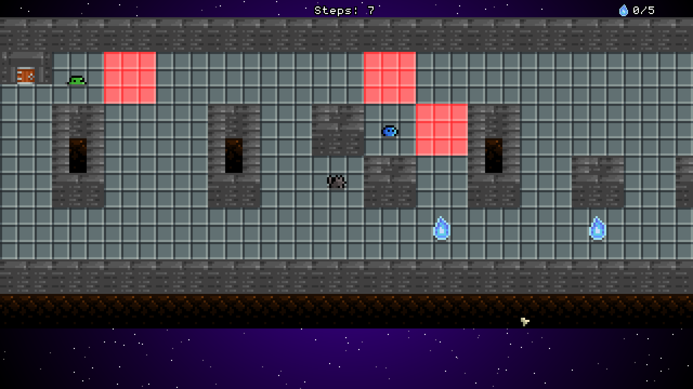

# Grim Fetcher

[Link to the download page (Itch.io)](https://lycorisbellua.itch.io/grim-fetcher)  

## Explanation

**Grim Fetcher** is written in C, with [GLFW](https://www.glfw.org) (version 
3.4.0) for the windowing, [OpenGL](https://docs.gl) (version 4.0+ required) for 
graphics, and [LodePNG](https://github.com/lvandeve/lodepng) to process PNG 
images. This came from a school project that I pushed much further.  

## Lore

The main character is a little dog whom people around me kept calling a cat, so 
now it's his name: Sua. It indeed means "cat" in Sumerian. Why Sumerian though, 
is he that old? Only gods know. What I know is that I'm quite fond of the word, 
as this was the first one I've learned in this language (not that I know 
Sumerian, don't @ me). In any case, Sua is a very good boy, with an important 
job. A dungeon keeps the souls of fallen adventurers, preventing them from 
joining the afterlife, and the dungeon is too dangerous for clerics to come 
resurrect them. This is when Sua dives in: he comes down into the dungeon to 
fetch as many souls he can before going back to the surface to release them.  

## Controls

| Action                            | Control                                                                            |
| --------------------------------- | ---------------------------------------------------------------------------------- |
| Movement with keyboard            | WASD, arrow keys, keypad with Num Lock off, or Page Up & Down                      |
| Movement with mouse               | Left click on a cell to automatically walk there, and click on an obstacle to stop |
| Zoom in and out                   | Mouse scroll wheel                                                                 |
| Quit                              | Click the window X button, Alt+F4, or Escape                                       |
| Restart from the first map        | F5                                                                                 |
| Toggle VSync (on by default)      | F10                                                                                |
| Toggle fullscreen                 | F11                                                                                |
| Toggle VSync status + FPS counter | F12                                                                                |

## Features

- Enemies wait for the player's first step to move.
- No attack button, dodge because you die on contact.
- The clicked path is calculated with the A\* pathfinding algorithm. It avoids 
obstacles and the red cells next to enemies, but the path isn't updated as 
enemies move, by design.
