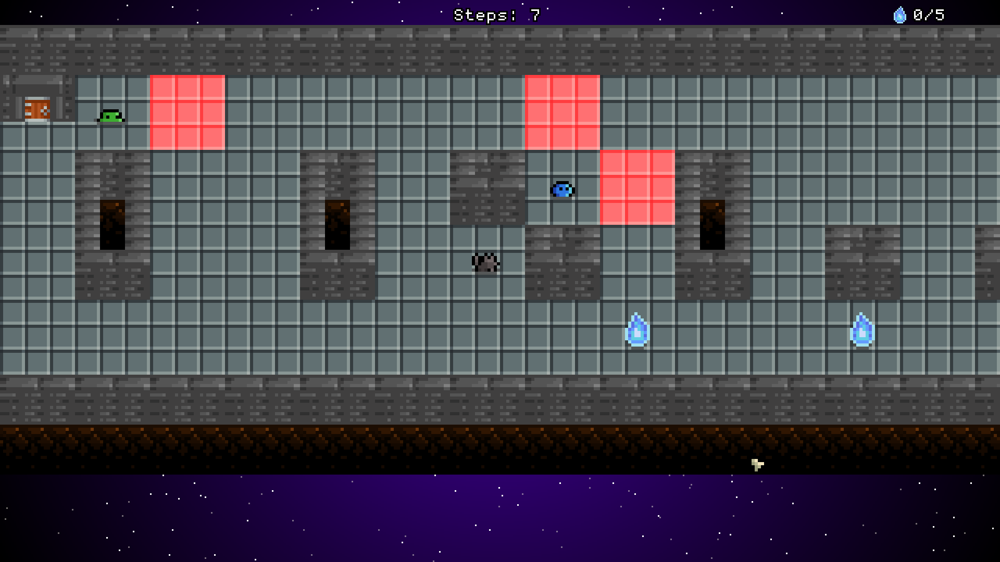

# Grim Fetcher

[Link to the download page (Itch.io)](https://lycorisbellua.itch.io/grim-fetcher)  

## Explanation

*Grim Fetcher* is a 2D game written in C. It originates from a school project 
which uses the MinilibX, a barebone C graphics library created for educational 
purposes. I'm publishing *Grim Fetcher* to GitHub because it goes much further 
than what the subject required. I've also seized the opportunity to port the 
project from MinilibX and its XPM format for images to OpenGL and PNG.  

As to whether this would ever become a real game, who knows? I love the 
concept, but I don't currently have time for this project. I don't even have 
time for a refactoring, and gods know it's needed. It has been tempting to 
scrap the whole thing and start over. That being said, I'm still proud of what 
I've made, and I can appreciate my progress from then to 
[Olafur](https://github.com/LycorisBellua/c_game_olafur).  

## Features

- The clicked path is calculated with the A\* pathfinding algorithm. It avoids 
obstacles and the red cells next to enemies, but the path isn't updated as 
enemies move.
- No attack button, dodge because you die on contact.
- Enemies wait for the player's first step to move.

## Controls

| Action                            | Control                                                           |
| --------------------------------- | ----------------------------------------------------------------- |
| Move up                           | `W`, `↑` (Up Arrow) or `Page Up`                                  |
| Move down                         | `S`, `↓` (Down Arrow) or `Page Down`                              |
| Move left                         | `A` or `←` (Left Arrow)                                           |
| Move right                        | `D` or `→` (Right Arrow)                                          |
| Keypad                            | With `Num Lock` off, `8` `2` `4` `6` act as the arrow keys        |
| Walk to a cell                    | Left click on it                                                  |
| Stop walking                      | Left click on the dog, an obstacle, a red cell or outside the map |
| Zoom in/out                       | Mouse scroll wheel                                                |
| Next map / retry                  | `Enter` on the end screen                                         |
| Quit                              | Click the window close (`X`) button, `Alt` + `F4`, or `Esc`       |
| Restart from the first map        | `F5`                                                              |
| Toggle VSync (on by default)      | `F10`                                                             |
| Toggle fullscreen                 | `F11`                                                             |
| Toggle VSync status + FPS counter | `F12`                                                             |

## Lore

The main character is a little dog whom people around me kept calling a cat, so 
now it's his name: Sua. It indeed means "cat" in Sumerian. Why Sumerian though, 
is he that old? Only gods know. What I know is that I'm quite fond of the word, 
as this was the first one I've learned in this language (not that I know 
Sumerian, don't @ me). In any case, Sua is a very good boy, with an important 
job. A dungeon keeps the souls of fallen adventurers, preventing them from 
joining the afterlife, and the dungeon is too dangerous for clerics to come 
resurrect them. This is when Sua dives in: he comes down into the dungeon to 
fetch as many souls he can before going back to the surface to release them.  
